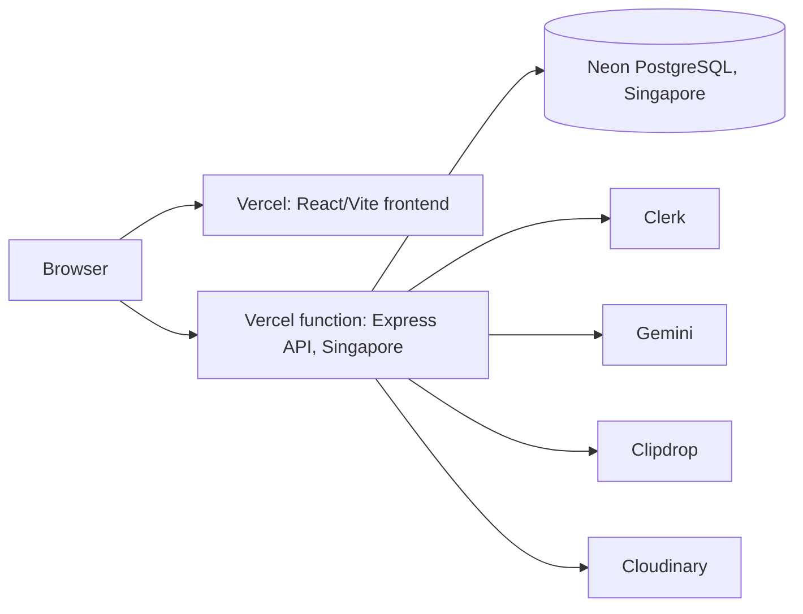
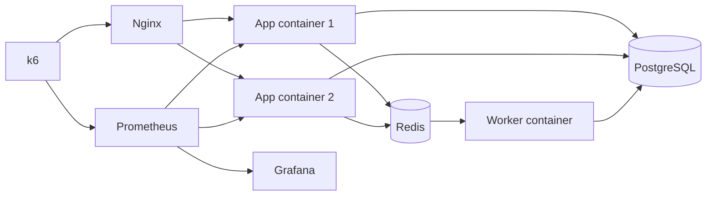

# OFA AI

> One website for most of your everyday AI tasks.

OFA AI is a full-stack AI productivity platform that brings writing, image generation, image editing, and resume feedback into one simple workspace. The application is built with a React and Vite frontend, an Express backend, Clerk authentication, Neon PostgreSQL storage, Cloudinary media processing, Google Gemini-compatible text generation, and Clipdrop image generation.

**Live application:** [ofa-ai.vercel.app](https://ofa-ai.vercel.app)

[](https://github.com/vikasprajapati-01/OFA-ai/actions/workflows/ci.yml)

---

## Why OFA AI?

AI tools are often spread across multiple websites and accounts. OFA AI provides a single authenticated workspace where users can create content, generate images, process images, review resumes, and revisit their previous creations.

The interface is designed to be approachable for everyday users while keeping the codebase simple enough to extend with new AI tools.

## Features

### AI writing tools

- **Article Generator** — Create structured articles from a topic and choose a short, medium, or long output length.
- **Blog Title Generator** — Generate title ideas for a topic across categories such as technology, health, travel, finance, education, food, lifestyle, entertainment, and sports.

### AI image tools

- **Image Generator** — Create images from text prompts with selectable styles including realistic, cartoon, Ghibli, anime, fantasy, 3D, and portrait.
- **Background Removal** — Upload an image and remove its background.
- **Object Removal** — Upload an image and remove a specified object from it.

### Resume tool

- **Resume Reviewer** — Upload a PDF resume and receive AI-generated feedback about structure, formatting, skills, experience, ATS keywords, strengths, weaknesses, and improvement opportunities.

### Workspace experience

- Clerk-powered sign-in and user sessions.
- Free and premium plan handling through Clerk plans.
- A free usage limit for supported text and image generation tools.
- Personal dashboard showing recent creations and the active plan.
- Saved creation history in Neon PostgreSQL.
- Light and dark themes.
- Responsive navigation for desktop and mobile layouts.
- Copy generated text to the clipboard.
- Download generated and processed images.
- Markdown rendering for generated articles, blog titles, and resume reviews.

---

## Tech stack

### Frontend

- React 19
- Vite
- React Router
- Tailwind CSS 4 with the Vite plugin
- Clerk React authentication
- Axios for API requests
- React Markdown for formatted AI output
- React Hot Toast for notifications

### Backend

- Node.js with native ES modules
- Express 5
- Clerk Express authentication middleware
- OpenAI-compatible client configured for Google Gemini
- Clipdrop Text-to-Image API
- Cloudinary for image uploads and transformations
- Neon serverless PostgreSQL
- Multer for multipart file uploads
- `pdf-parse` for reading resume PDFs
- `express-rate-limit` (60 requests per minute per user by default)
- Optional Redis cache for the history list

### Deployment

- Vercel configuration is included for both the frontend and backend.
- The frontend is configured as a Vite application.
- The backend is configured to run through Vercel's Node.js runtime (function region: Singapore, next to the Neon database).

### Performance and scaling lab (optional, local only)

- Docker Compose, Nginx load balancer, PostgreSQL and Redis containers
- BullMQ job queue with a separate worker container
- Prometheus and Grafana dashboards
- k6 load, failover, soak and upload tests
- GitHub Actions CI

None of this runs in production. See [Performance and scaling lab](#performance-and-scaling-lab) and [docs/LAB.md](docs/LAB.md).

---

## Project structure

```text
OFA-ai/
├── backend/
│   ├── config/
│   │   ├── cache.js            # Optional Redis cache for the history list
│   │   ├── cloudinary.js       # Cloudinary configuration
│   │   ├── db.js               # Neon client and free-usage accounting (lab: local Postgres pool)
│   │   ├── metrics.js          # Prometheus metrics (lab only, METRICS=true)
│   │   ├── multer.js           # Temporary upload handling
│   │   └── queue.js            # BullMQ queue (lab only, QUEUE_ENABLED=true)
│   ├── controller/
│   │   ├── aiController.js     # AI generation and image processing logic
│   │   ├── queueController.js  # Async job endpoints (lab only)
│   │   └── userController.js   # User creation-history logic
│   ├── middleware/
│   │   └── auth.js             # Clerk authentication and plan checks (lab: fake login in test mode)
│   ├── routes/
│   │   ├── aiRoutes.js         # AI tool endpoints
│   │   ├── queueRoutes.js      # Async job routes (lab only)
│   │   └── userRoutes.js       # User endpoints
│   ├── services/
│   │   └── aiText.js           # Gemini text calls (lab: simulated AI in test mode)
│   ├── server.js               # Express application entry point
│   ├── worker.js               # Queue worker process (lab only)
│   ├── Dockerfile
│   ├── .env.example
│   ├── package.json
│   └── vercel.json
│
├── frontend/
│   ├── public/                 # Public assets and icons
│   ├── src/
│   │   ├── assets/             # Branding and tool configuration
│   │   ├── components/         # Shared UI components
│   │   ├── context/            # Theme context
│   │   ├── pages/              # Public pages and AI tool pages
│   │   ├── App.jsx             # Application routes
│   │   ├── index.css           # Global styles and themes
│   │   └── main.jsx            # React application entry point
│   ├── .env.example
│   ├── package.json
│   ├── vite.config.js
│   └── vercel.json
│
├── loadtest/                   # k6 scripts and schema.sql for the lab
├── grafana/                    # Provisioned dashboards (lab)
├── prometheus/                 # Scrape configuration (lab)
├── docs/LAB.md                 # Lab guide and detailed measurements
├── .github/                    # CI workflow and Dependabot
├── docker-compose.yml          # Self-contained local lab
├── nginx.conf                  # Load balancer for the lab
└── README.md
```

---

## Requirements

Before running OFA AI locally, install:

- Node.js 22 (the version used in CI and in the Docker images)
- npm 9 or newer
- A Clerk application
- A Neon PostgreSQL database
- A Cloudinary account
- A Google AI Studio API key with Gemini API access
- A Clipdrop API key

Docker and k6 are only needed if you want to run the optional [scaling lab](#performance-and-scaling-lab).

---

## Environment variables

Copy `backend/.env.example` to `backend/.env` and fill in the following variables:

```env
PORT=3000

# Neon PostgreSQL
DATABASE_URL=your_neon_database_connection_string

# Clerk server credentials (the backend needs both keys)
CLERK_PUBLISHABLE_KEY=your_clerk_publishable_key
CLERK_SECRET_KEY=your_clerk_secret_key

# Google Gemini API key
GEMINI_API_KEY=your_gemini_api_key

# Clipdrop image generation
CLIPDROP_API_KEY=your_clipdrop_api_key

# Cloudinary
CLOUDINARY_CLOUD_NAME=your_cloudinary_cloud_name
CLOUDINARY_API_KEY=your_cloudinary_api_key
CLOUDINARY_API_SECRET=your_cloudinary_api_secret
```

Optional backend variables:

| Variable | Effect |
| --- | --- |
| `RATE_LIMIT_PER_MIN` | Per-user API request limit per minute (default `60`). |
| `REDIS_URL` | Turns on the history-list cache. Without it the cache is simply off. |
| `ENABLE_DB_HEALTH=true` | Exposes `GET /api/health/db` (one database round trip plus the Vercel region). Off by default. |

Create `frontend/.env` from `frontend/.env.example` with the following variables:

```env
# Public Clerk key used by the browser
VITE_CLERK_PUBLISHABLE_KEY=your_clerk_publishable_key

# Public URL of the deployed backend API
VITE_BASE_URL=http://localhost:3000
```

For a deployed frontend, replace `VITE_BASE_URL` with the public URL of the backend, for example:

```env
VITE_BASE_URL=https://your-backend-domain.vercel.app
```

### Security notes

- Never commit `.env` files, API keys, Clerk secrets, database credentials, or Cloudinary secrets.
- Only expose browser-safe values through `VITE_*` variables.
- Keep `CLERK_SECRET_KEY`, `GEMINI_API_KEY`, `CLIPDROP_API_KEY`, `DATABASE_URL`, and Cloudinary secrets on the server.
- If a secret is exposed, revoke and replace it immediately in the provider dashboard.

---

## Database setup

The backend uses two PostgreSQL tables. The same definitions are in [`loadtest/schema.sql`](loadtest/schema.sql), which CI and the local lab use to create the tables from scratch. Run them in your Neon database before using the dashboard and AI tools:

```sql
CREATE TABLE IF NOT EXISTS creations (
    id serial PRIMARY KEY,
    user_id text NOT NULL,
    prompt text NOT NULL,
    content text NOT NULL,
    type text NOT NULL,
    created_at timestamptz DEFAULT now()
);

CREATE TABLE IF NOT EXISTS user_usage (
    user_id text PRIMARY KEY,
    free_usage integer NOT NULL DEFAULT 0
);

CREATE INDEX IF NOT EXISTS idx_creations_user_created ON creations (user_id, created_at DESC);
```

- `creations` stores the saved results.
- `user_usage` counts free generations. A slot is reserved atomically before an AI call and given back if the call fails.

The application stores the following creation types:

- `article`
- `blog-title`
- `image`
- `resume-review`

---

## Run locally

The frontend and backend are separate Node.js applications, so install and run them in separate terminals.

### 1. Clone the repository

```bash
git clone https://github.com/vikasprajapati-01/OFA-ai.git
cd OFA-ai
```

### 2. Install backend dependencies

```bash
cd backend
npm install
```

Add the backend environment variables to `backend/.env`, then start the development server:

```bash
npm run server
```

The backend runs on `http://localhost:3000` by default.

### 3. Install frontend dependencies

Open a second terminal from the repository root:

```bash
cd frontend
npm install
```

Add the frontend environment variables to `frontend/.env`, then start Vite:

```bash
npm run dev
```

Open the local URL shown by Vite, usually `http://localhost:5173`.

---

## Available scripts

### Frontend

Run these commands from `frontend/`:

| Command | Purpose |
| --- | --- |
| `npm run dev` | Start the Vite development server. |
| `npm run build` | Create a production build in `dist/`. |
| `npm run preview` | Preview the production build locally. |
| `npm run lint` | Run ESLint checks. |

### Backend

Run these commands from `backend/`:

| Command | Purpose |
| --- | --- |
| `npm run server` | Start the backend with Nodemon for development. |
| `npm start` | Start the backend with Node.js. |

---

## API reference

All AI and user endpoints require a valid Clerk bearer token unless noted otherwise.

Requests are rate limited per user (per IP when not signed in): 60 per minute by default, answered with `429`. JSON bodies are limited to 100 KB, and uploads to 10 MB (`413`).

### Health check

```http
GET /
```

Returns a simple `Server Live` response when the backend is running.

### AI endpoints

#### Generate an article

```http
POST /api/ai/generate-article
Content-Type: application/json
Authorization: Bearer <clerk_token>
```

Request body:

```json
{
  "prompt": "Write an article about the future of renewable energy in Medium (800-1200 words).",
  "length": 1200
}
```

#### Generate blog titles

```http
POST /api/ai/generate-blog-title
Content-Type: application/json
Authorization: Bearer <clerk_token>
```

Request body:

```json
{
  "prompt": "Generate blog titles about artificial intelligence in the Technology category."
}
```

#### Generate an image

```http
POST /api/ai/generate-image
Content-Type: application/json
Authorization: Bearer <clerk_token>
```

Request body:

```json
{
  "prompt": "Generate an image of a futuristic city at sunset in the Anime style."
}
```

#### Remove an image background

```http
POST /api/ai/remove-image-bg
Content-Type: multipart/form-data
Authorization: Bearer <clerk_token>
```

Form field:

- `image` — the image file to process.

#### Remove an object from an image

```http
POST /api/ai/remove-image-object
Content-Type: multipart/form-data
Authorization: Bearer <clerk_token>
```

Form fields:

- `image` — the image file to process.
- `object` — a single-word description of the object to remove.

#### Review a resume

```http
POST /api/ai/review-resume
Content-Type: multipart/form-data
Authorization: Bearer <clerk_token>
```

Form field:

- `resume` — a PDF file up to 5 MB. Files over 5 MB return `413`, non-PDF files return `400`, and a PDF that cannot be read returns `400` with a clear message.

### User endpoint

#### Get the authenticated user's creations

```http
GET /api/user/get-user-creations
Authorization: Bearer <clerk_token>
```

Returns the authenticated user's saved creations, ordered from newest to oldest. Optional query parameters: `limit` (1 to 100, default 50) and `offset`. The list does not include the generated text of articles, titles and resume reviews (image URLs are included), to keep the response small.

#### Get one creation

```http
GET /api/user/get-creation/:id
Authorization: Bearer <clerk_token>
```

Returns the full content of one creation, only if it belongs to the authenticated user (`404` otherwise).

---

## Authentication and plans

OFA AI uses Clerk for authentication and plan management.

- The frontend obtains a Clerk session token and sends it as a bearer token.
- The backend uses Clerk middleware to read the authenticated user.
- The backend determines whether the user has the `premium` plan.
- Free users have a limit of 10 supported text/image generations.
- Background removal, object removal, and resume review are premium-only features.
- Generated results are associated with the authenticated Clerk user ID before being stored in Neon.

To enable premium access in Clerk, configure a plan with the identifier `premium` and make sure the plan is available through your Clerk billing setup.

---

## Production deployment

The repository includes deployment configuration for Vercel.

### Deploy the backend

1. Create a new Vercel project using this repository.
2. Set the project root directory to `backend`.
3. Add every variable from `backend/.env` to the Vercel project environment settings.
4. Deploy the project.
5. Confirm the backend health check responds at the deployed URL:

```text
https://your-backend-domain.vercel.app/
```

### Deploy the frontend

1. Create a second Vercel project using the same repository.
2. Set the project root directory to `frontend`.
3. Add `VITE_CLERK_PUBLISHABLE_KEY`.
4. Set `VITE_BASE_URL` to the deployed backend URL.
5. Deploy the project.
6. Add the frontend domain to the allowed origins and redirect URLs in Clerk.

### Production checklist

Before sharing the application publicly:

- Verify the frontend can sign in and sign out successfully.
- Verify the backend health check returns successfully.
- Verify the frontend `VITE_BASE_URL` points to the production backend, not localhost.
- Add the production frontend URL to Clerk's allowed origins and redirect URLs.
- Confirm the production database contains the `creations` and `user_usage` tables and the index.
- Confirm Cloudinary uploads and transformations work in production.
- Confirm Gemini and Clipdrop API keys are active and have sufficient quota.
- Confirm premium features are restricted to premium users.
- Run `npm run build` in `frontend/` before deployment (`npm run lint` currently reports old style issues, see Known limitations).
- Make sure `LOAD_TEST`, `QUEUE_ENABLED` and `METRICS` are **not** set in production.
- Review provider logs after the first production request.
- Keep all server-side secrets out of the frontend build and Git history.

---

## Application flow

1. A visitor opens the public landing page.
2. Clerk handles authentication when the visitor enters the AI workspace.
3. The frontend sends authenticated requests to the Express API.
4. The backend validates the Clerk session and checks the user's plan.
5. The selected controller calls the relevant AI, image, storage, or database service.
6. The result is returned to the frontend and saved to the user's creation history where applicable.
7. The dashboard retrieves the user's saved creations from Neon PostgreSQL.

---

## Error handling and operational notes

- API errors are returned as JSON objects with `success: false` and a `message` field.
- Uploaded files are temporarily handled by Multer and removed after processing.
- Resume uploads are limited to 5 MB by the backend controller (10 MB at the upload layer).
- A PDF that cannot be parsed returns `400`, not a server error.
- AI output is rendered as Markdown in the frontend.
- Image outputs are stored or transformed through Cloudinary before being returned to the client.
- Free usage is counted in the PostgreSQL `user_usage` table. A usage slot is reserved before the AI call and returned if the call fails. Older counters stored in Clerk metadata are copied once, when a user's row is first created.

For production operations, monitor Vercel logs, Clerk events, Neon database activity, Cloudinary usage, and AI provider quotas together. A failure in any external provider can prevent a tool from returning a result.

---

## Performance and scaling lab

OFA AI is also a hands-on project about how a web service behaves under load: what breaks, why, which fix helps, and what the numbers say before and after. Everything below runs locally in Docker with **simulated AI responses** (no real Gemini or Clipdrop calls) and dummy credentials.

### Production architecture



### Lab architecture



### Run it

```bash
git clone https://github.com/vikasprajapati-01/OFA-ai.git
cd OFA-ai
docker compose up -d --build --scale app=2
docker compose restart nginx
k6 run -e SECRET=lab-secret -e BASE_URL=http://localhost:8080 loadtest/smoke.js
```

Grafana is at http://localhost:3030 and Prometheus at http://localhost:9090. The full guide (resetting data, every test, scaling the app and the worker, failure injection) is in [docs/LAB.md](docs/LAB.md).

### Results at a glance

All lab numbers come from one laptop (Intel i5-13450HX, 16 GB RAM, Docker given about 8 GB), single runs unless stated, with the load generator and the system under test sharing the same CPU. AI calls are simulated with fixed waits of 0.8 to 2.5 seconds.

| Topic | Result |
| --- | --- |
| Database distance (production) | Moving the Vercel function region from Washington to Singapore, next to Neon, cut a database round trip from a median of 225 ms to 3 ms (15 samples each). |
| One vs two app containers | At 1,500 requests per second for about two minutes, one container fell behind (13% of requests never sent, article p95 13.4 s). Two containers behind Nginx handled the same load with nothing dropped and article p95 857 ms. |
| Losing a container | Killing one of two containers at 600 requests per second: 148 of 85,791 requests failed (0.17%; an identical earlier run: 163 of 85,714). With graceful shutdown (finish running requests, then exit): 0 of 85,740 failed. |
| Job queue | A queued request is accepted in a median of 5.7 ms, against 813 ms when waiting for the simulated AI. All 601 jobs completed in each of three bursts. Concurrent AI calls are capped by the worker setting (5 or 20). A 600-job burst drained in 94 s at concurrency 5 and 20.6 s at concurrency 20. |
| Worker crash | Killing the worker mid-burst: 601 of 601 jobs saved, no duplicates seen, API stayed responsive. |
| Retries | With 70% simulated AI failures, jobs retried up to 3 times, and the free-usage counter always matched the saved results (6 of 6). |
| History list cache (Redis) | In a simulated 500-user test where about 55% of requests were history reads and about 51% were cache hits, mean list latency was 35 to 49% lower. The effect depends on that workload assumption. |
| Soak test | 30 minutes at 200 requests per second: 364,589 requests, 0 failed, 10 dropped. The JavaScript heap stayed flat at about 30 MiB; process memory crept up by roughly 1 to 2 MiB per 6 minutes toward the end. |
| Dependencies | `npm audit` reports 0 vulnerabilities for production dependencies in both apps (2 moderate findings remain in the backend development tools). |

Details, methods and caveats are in [docs/LAB.md](docs/LAB.md).

### Test mode and production safety

The lab needs fake logins and simulated AI. Those hooks are in the code, but they are switched on only by `LOAD_TEST=true`, which production never sets.

- Test mode adds fake logins through `x-load-test-*` headers (they need `LOAD_TEST_SECRET`), simulated AI, image and upload responses, a local PostgreSQL pool, and extra monitoring logs.
- The server refuses to start in test mode if the secret is missing, if it runs on Vercel, or if a live Clerk key is configured.
- Metrics (`METRICS=true`), the job queue (`QUEUE_ENABLED=true`) and the database health endpoint (`ENABLE_DB_HEALTH=true`) each load their code only when switched on.
- A CI job named **Production mode** starts the server without test mode and checks that fake logins are refused (`401`) and that `/metrics`, `/api/queue/*` and `/api/health/db` do not exist.

### Known limitations

- The queue, worker, metrics and Redis cache are lab features and are not deployed. The production backend runs as serverless functions on Vercel, which have no place to run an always-on worker or to be scraped by Prometheus.
- The lab says nothing about the real Gemini or Clipdrop quotas and latencies, because those calls are simulated.
- After a container disappears, Nginx (open source, passive health checks) can leave a few requests waiting up to about 38 seconds. A proxy with active health checks would likely avoid that; this was not tested.
- Rate-limit counters live in each app instance and are not shared.
- `pdf-parse` 1.x uses an old PDF parser. A tiny hand-made test PDF was rejected intermittently, while a real resume parsed 401 times out of 401. Unusual PDFs may fail and now return a clear `400`.
- `npm run lint` in `frontend/` reports 24 old style errors (mostly unused `React` imports). They do not affect the build.
- `prom-client` is marked deprecated by its authors in favour of `@prometheus-io/client`.

---

## Troubleshooting

### The frontend cannot reach the backend

Check that:

- The backend is running.
- `VITE_BASE_URL` is correct.
- The backend URL does not contain an extra trailing path.
- CORS is configured correctly for the deployed frontend.
- The browser is not trying to call `localhost` in a production build.

### Authentication fails

Check that:

- `VITE_CLERK_PUBLISHABLE_KEY` belongs to the correct Clerk instance.
- `CLERK_PUBLISHABLE_KEY` and `CLERK_SECRET_KEY` are both configured on the backend.
- The frontend domain is allowed in Clerk.
- The backend receives the `Authorization: Bearer <token>` header.

### AI generation fails

Check that:

- `GEMINI_API_KEY` is valid and has access to the configured Gemini model.
- `CLIPDROP_API_KEY` is valid for image generation.
- The provider quota has not been exhausted.
- The request is authenticated.
- The user has not reached the free usage limit.

### The dashboard is empty

Check that:

- The Neon `creations` table exists.
- `DATABASE_URL` points to the correct database.
- The authenticated Clerk user ID is being used consistently.
- The backend has permission to connect to Neon.

### File processing fails

Check that:

- The request uses `multipart/form-data`.
- The field names are exactly `image` for image tools and `resume` for resume review.
- The resume is a PDF and is no larger than 5 MB.
- Cloudinary credentials are configured correctly.

---

## Contributing

Contributions are welcome when they improve reliability, usability, security, or the range of supported AI tools.

Recommended workflow:

1. Create a feature branch from `master`.
2. Keep frontend and backend changes focused and easy to review.
3. Add or update documentation for new environment variables or endpoints.
4. Run the frontend production build locally. CI also runs the lab smoke test, a production-mode check and the frontend build on every push and pull request.
5. Test authenticated, unauthenticated, free-plan, and premium-plan behavior.
6. Open a pull request with a clear description of the change.

When adding a new AI tool, update the relevant frontend navigation, tool data, page component, backend route, controller, database creation type, and this README's API documentation.

---

## License

No open-source license is currently declared in this repository. Unless the repository owner adds a license, all rights are reserved by the copyright holder.

---

## Project links

- **Repository:** [github.com/vikasprajapati-01/OFA-ai](https://github.com/vikasprajapati-01/OFA-ai)
- **Live application:** [ofa-ai.vercel.app](https://ofa-ai.vercel.app)